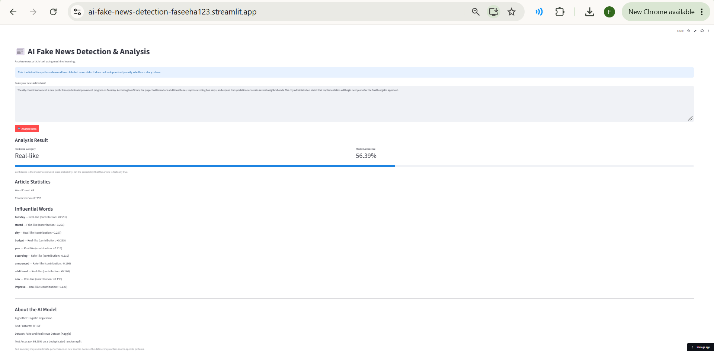
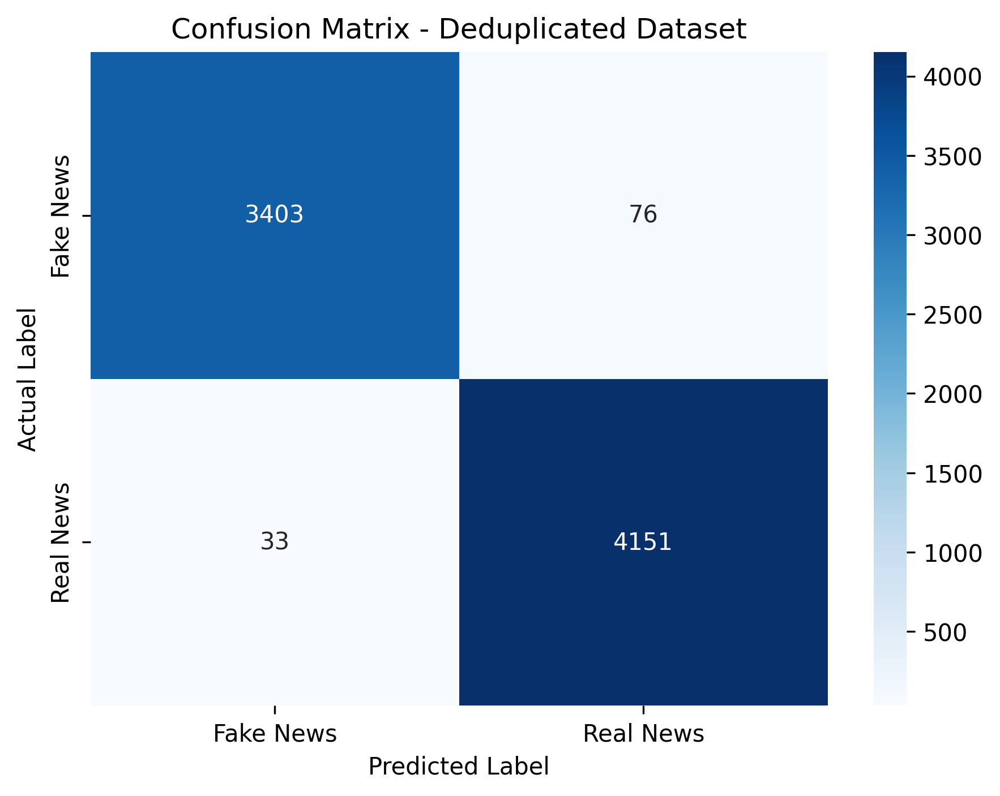
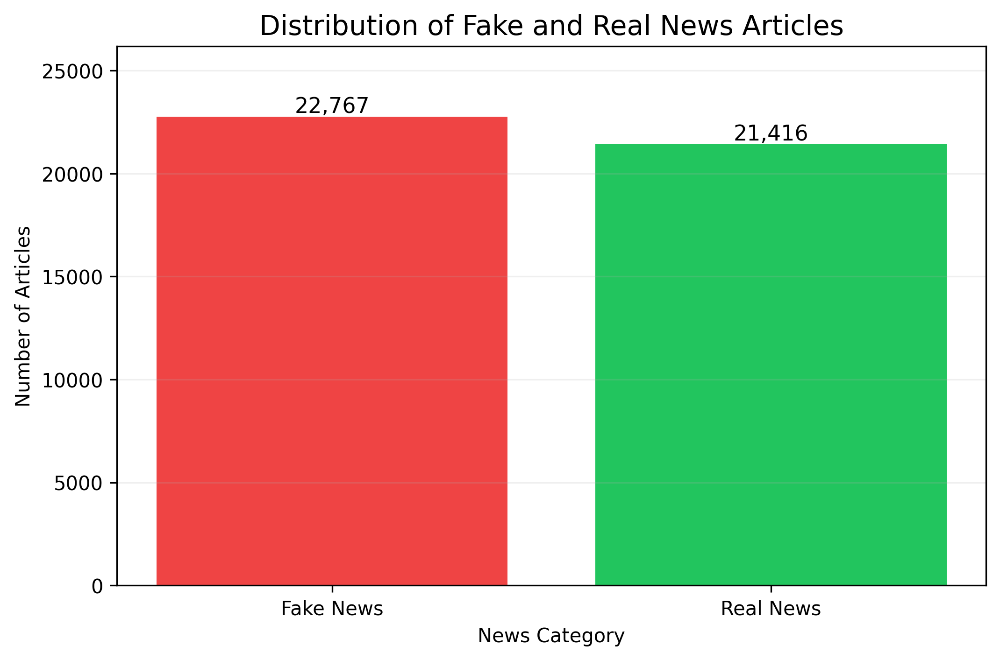

# 📰 AI Fake News Detection & Analysis

An interactive machine learning web application that classifies news article text as **Real-like** or **Fake-like** using Natural Language Processing (NLP).

Built with Python, Scikit-learn, TF-IDF, and Streamlit.

## Project Overview

This project demonstrates an end-to-end NLP workflow, including data preprocessing, machine learning, model evaluation, and an interactive web application.

Users can paste news article text and receive a prediction, model confidence score, article statistics, and influential word analysis.

**Important:** This application does not independently verify whether news is factually true.

## Live Application Demo

[Try the AI Fake News Detection App](https://ai-fake-news-detection-faseeha123.streamlit.app/)

## Features

- Interactive Streamlit web application
- Real-like and Fake-like predictions
- Model confidence scores
- Article word and character counts
- Influential word analysis
- Comparison of two machine learning algorithms
- Confusion matrix and dataset visualizations

## Technologies Used

- Python
- Scikit-learn
- Pandas and NumPy
- TF-IDF
- Logistic Regression
- Multinomial Naive Bayes
- Streamlit
- Matplotlib and Seaborn
- Joblib

## Dataset

**Dataset:** Fake and Real News Dataset

**Source:** [Kaggle](https://www.kaggle.com/datasets/clmentbisaillon/fake-and-real-news-dataset)

| Description | Count |
|---|---:|
| Articles after cleaning | 44,183 |
| Duplicate articles removed | 5,870 |
| Unique articles | 38,313 |
| Training articles | 30,650 |
| Testing articles | 7,663 |
| TF-IDF features | 5,000 |

## Model Performance

| Model | Test Accuracy |
|---|---:|
| Logistic Regression | 98.58% |
| Multinomial Naive Bayes | 93.63% |

**Selected model:** Logistic Regression.

Results were measured on a deduplicated random train/test split. Performance on unfamiliar news sources may differ.

## Visualizations

### Confusion Matrix

### Dataset Distribution

## How to Run

Install dependencies:

    python -m pip install -r requirements.txt

Launch the application:

    python -m streamlit run app.py

Open **http://localhost:8501** in your browser.

## Project Structure

- `app.py` — Streamlit application
- `fake_news_model.pkl` — Trained classifier
- `tfidf_vectorizer.pkl` — Text vectorizer
- `confusion_matrix.png` — Model evaluation chart
- `news_distribution.png` — Dataset visualization
- `requirements.txt` — Dependencies
- `README.md` — Project documentation

## Limitations

- This model is not a fact-checking service.
- Predictions may reflect source-specific writing patterns.
- Confidence does not guarantee factual accuracy.
- The current application supports English text.

## Future Improvements

- Evaluate on independent news sources
- Improve model explainability
- Detect near-duplicate articles
- Deploy the app online

## Author

Developed as an AI/ML portfolio project.
